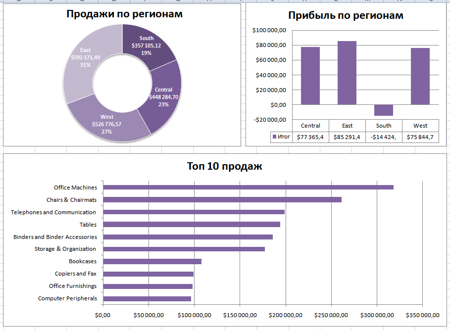
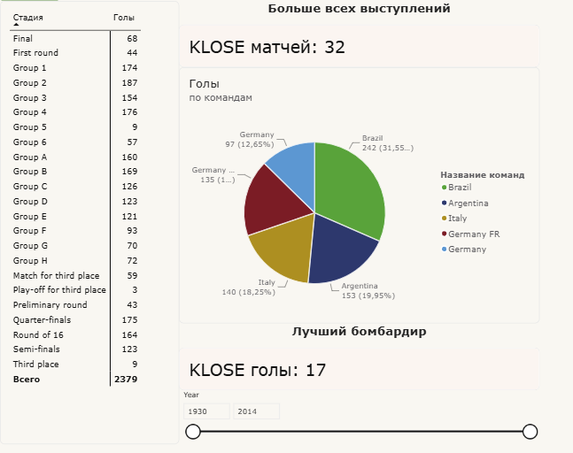

# Excel and Power BI
There are some things that cover topics related to statistics and data visualization. 
В репозитории представлены файлы с ответами на некоторые статистические вопросы и визуализацию данных через Excel и Power BI.
## Table of Contents 
1. [Adult Census Income](#1-adult-census-income)
2. [Amazon Top 50 Bestselling Books 2009 - 2019](#2-amazon-top-50-bestselling-books-2009---2019)
3. [Boston Housing](#3-boston-housing)
4. [Super Store Sales](#4-super-store-sales)
5. [FIFA World Cup](#5-fifa-world-cup)
## Theme descriptions
### 1. Adult Census Income
There are answers to questions such as: 
 
What is the proportion of people who earn more than $50K? 
What is the average age of people who earn more than $50K? 
What is the correlation between age and education level? 
What is the proportion of men and women who earn more than $50K? 
What is the median hours worked per week for people who earn more than $50K? 
 
Представлены ответы на вопросы: 
 
Какова доля людей, зарабатывающих более 50 тысяч долларов? 
Каков средний возраст людей, зарабатывающих более 50 тысяч долларов? 
Какова корреляция между возрастом и уровнем образования? 
Какова доля мужчин и женщин среди тех, кто зарабатывает более 50 тысяч долларов? 
Каково медианное количество рабочих часов в неделю для людей, зарабатывающих более 50 тысяч долларов?

### 2. Amazon Top 50 Bestselling Books 2009 - 2019
There are answers to questions such as: 
 
What is the average rating of the books? 
What is the distribution of the number of reviews received by the books? 
Which book has the highest price? 
What is the correlation between the rating and the price of the books? 
What is the distribution of the genres of the books? 
 
Представлены ответы на вопросы: 
 
Каков средний рейтинг книг? 
Как распределено количество отзывов? 
У какой книги самая высокая цена? 
Какова корреляция между рейтингом и ценой книг? 
Как распределены жанры книг?

### 3. Boston Housing
There are answers to questions such as: 
 
What is the correlation between the number of rooms and the median value of owner-occupied homes? 
Which variable has the highest correlation with the median value of owner-occupied homes? 
 
Представлены ответы на вопросы: 
 
Какова корреляция между количеством комнат и медианной стоимостью домов, в которых проживают их собственники? 
Какая переменная имеет наибольшую корреляцию с медианной стоимостью домов, в которых проживают их собственники?

### 4. Super Store Sales
There are answers to questions such as: 
 
What is the total revenue generated by the store? 
Which category of products contributes the most to sales? 
How has the sales trend been for the year? 
Which region has the highest sales and which one has the lowest? 
What is the profit margin of the store? 
Also there are pivot tables and dashboard. 
 
Представлены ответы на вопросы: 
 
Какова общая выручка магазина? 
Какая категория товаров вносит наибольший вклад в продажи? 
Какова динамика продаж за год? 
В каком регионе объем продаж самый высокий, а в каком самый низкий? 
Какова рентабельность магазина? 
Также построены сводные таблицы и дашборд.  

### 5. FIFA World Cup
Based on three separate tables—WorldCup, WorldCupMatches, and WorldCupPlayers—a Power BI dashboard has been created using Power Query, a Power Pivot data model, and pivot tables, featuring a slicer for years. 
 
На основе трех разных таблицы WorldCup, WorldCupMatches, WorldCupPlayers, используя Power Query, модель данных Power Pivot и сводных таблиц, построен дашборд в Power BI со срезом по годам.  

